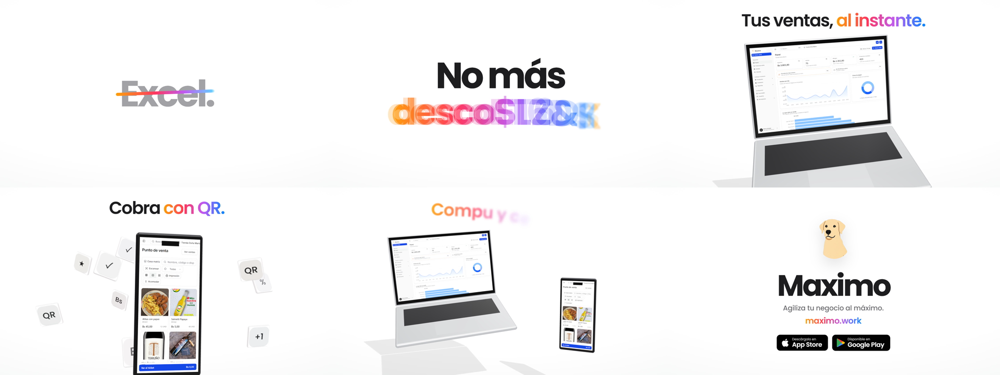
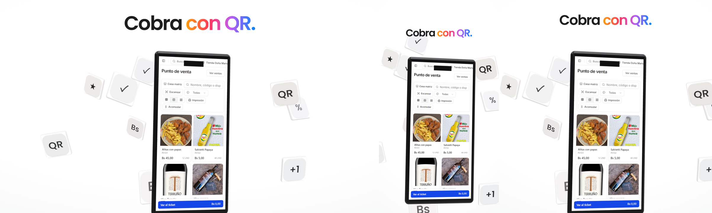
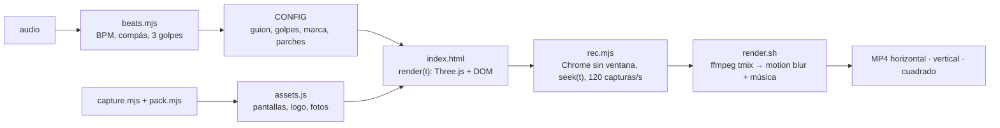

<div align="center">

<a href="https://github.com/DannerAly/promo-video-3d/releases/latest"></a>

# Promo Video 3D

**Una skill para Claude que convierte tu app en un video promocional de 30 segundos estilo Apple: una compu y un celular en 3D mostrando tus pantallas reales, y letras que entran en cada golpe de la música.**

HTML + Three.js, grabado cuadro por cuadro con motion blur real. Horizontal, vertical y cuadrado desde el mismo archivo.

[**🌐 Sitio web**](https://alydanner.me/promo-video-3d/) · [**▶ Ver el demo (MP4)**](https://github.com/DannerAly/promo-video-3d/releases/latest) · [Instalar](#instalar) · [Uso](#uso) · [Cómo funciona](#cómo-funciona) · [🇺🇸 English](README.md)

[](LICENSE)
[](https://code.claude.com/docs/en/skills)
[](https://threejs.org)
[](https://ffmpeg.org)
[](https://github.com/DannerAly/promo-video-3d/stargazers)

</div>

---

Sin editor de video y sin poner fotogramas clave a mano. Le das a Claude tu app, una canción y la idea. Escribe un guion corto, mide el ritmo, captura tu producto, lo pone en una compu y un celular 3D y anima las palabras para que cada una caiga en un golpe. Después graba la página cuadro por cuadro y te entrega tres MP4.



## Qué trae

- 🎵 **Al ritmo de la música.** Un script mide los BPM, el primer golpe del compás y los «3 golpes» rápidos que cierran cada frase. Cada palabra entra en un golpe y cada corte cae en un compás.
- 💻 **Compu y celular 3D** (Three.js) con **capturas reales** de tu producto, lo bastante cerca para leerse. La cámara se acerca hasta meterse en la pantalla.
- ✍️ **Tipografía cinética:** palabras tachadas en cada golpe, letras que se descifran desde símbolos al azar, una palabra que estalla, golpes de una palabra y letras que suben con blur y giro.
- 🖼️ **Parches de pantalla:** pon fotos reales de productos en el punto de venta, cambia un nombre viejo y tapa indicadores de desarrollo, todo desde `CONFIG`.
- 🎞️ **Motion blur real:** 4 submuestras por cuadro en medio cuadro (obturador de 180°), promediadas con ffmpeg.
- 📐 **Tres formatos desde un archivo:** 1920×1080, 1080×1920 y 1080×1080. El tamaño del texto y la distancia de la cámara se adaptan a cada uno.
- 🍎 **Estilo Apple:** fondo blanco, una sola tipografía, un solo degradado y curvas de velocidad suaves.
- 🧪 **Revisión visual:** saca cualquier segundo como imagen antes de renderizar todo.



## Instalar

### Claude Code (recomendado)

```text
/plugin marketplace add DannerAly/promo-video-3d
/plugin install promo-video-3d@danneraly-promo
```

### Manual (carpeta de skills)

```bash
git clone https://github.com/DannerAly/promo-video-3d.git
cp -r promo-video-3d/skills/promo-video-3d ~/.claude/skills/
```

### Claude.ai y Claude Desktop

Descarga **`promo-video-3d.zip`** del [último release](https://github.com/DannerAly/promo-video-3d/releases/latest) y súbelo en **Personalizar → Skills → + → Subir una skill**. Para renderizar hace falta una máquina con Chrome y ffmpeg, así que donde mejor funciona es en Claude Code.

## Uso

> Haz un video corporativo de 30 segundos de mi sistema, con la compu y el celular en 3D y letras al ritmo de la música. Usa esta canción: `~/Descargas/tema.mp4`. Dámelo en horizontal, vertical y cuadrado.

> Make a 30‑second Apple‑style promo for my app. Show the dashboard on a laptop and the checkout on a phone.

Qué hace Claude:

1. **Guion primero:** lo de antes → el problema → la promesa → la compu → el celular → los dos juntos → cierre, de 1 a 4 palabras por golpe.
2. **Mide el ritmo** con `scripts/beats.mjs` y te pide confirmar de oído los «3 golpes». Puedes responder en `mm:ss:cc`.
3. **Captura tu producto** con `scripts/capture.mjs` (con inicio de sesión opcional) y empaqueta las imágenes con `scripts/pack.mjs`.
4. **Llena el `CONFIG`** en una copia de la plantilla.
5. **Revisa imágenes sueltas** en los tres formatos para detectar choques y equipos cortados.
6. **Renderiza** con `scripts/render.sh` y abre los videos.

## Cómo funciona



- `render(t)` dibuja el estado exacto del segundo `t` sin depender del cuadro anterior. Por eso se puede grabar a cualquier velocidad y con submuestras.
- Los tiempos se escriben en **compases y pulsos** (`br(k)`, `bt(n)`) a partir de `CONFIG.bpm` y `CONFIG.firstBeat`: si cambias la canción, todo se mueve junto.
- Los equipos siguen pistas de poses `{x, y, z, rx, ry, rz, s}` con curvas cubic‑bezier como las de CSS.
- Las pantallas son texturas de canvas: tu captura más los `CONFIG.patches`.

## Personalizar

Todo está en un bloque al principio de `template/index.html`:

```js
window.CONFIG = {
  audio: 'audio.m4a', duration: 30,
  bpm: 114, firstBeat: 0.08,
  hits: [[5.30, 5.83, 6.37], [15.83, 16.37, 16.90], [24.27, 24.83, 25.30]],
  hitWords: [['Planea.', 'Cobra.', '*Crece.'], ['Web.', '*Móvil.', 'Equipo.'], ['Más simple.', 'Más rápido.', '*Mejor.']],
  strike: ['Cuaderno.', 'Excel.', 'Correos.', 'Papelitos.'],
  problem: ['No más', '*caos.'],
  promise: ['Todo simple,', 'a la mano'],
  laptopHead: 'Todo tu negocio, *en *un *lugar.',
  // … stack, bridge, phoneHead, decode, duoHead, tiles
  brand: { name: 'Nova', tagline: 'Tu negocio, más simple.', url: 'tuapp.com', appStore: true, googlePlay: true },
  patches: { laptop: [], phone: [] },
};
```

Un `*` delante de una palabra la pinta con el degradado. La estructura toma por toma y más ideas de guion están en [`references/patterns.md`](skills/promo-video-3d/references/patterns.md).

## Scripts

```bash
S=skills/promo-video-3d/scripts
node $S/beats.mjs audio.m4a                                  # BPM, compás y candidatos a 3 golpes
node $S/capture.mjs capturas "laptop|https://app/x|1600|1000|1.2|0" "phone|https://app/y|390|845|2|1"
node $S/pack.mjs mi-video laptop=capturas/laptop.png phone=capturas/phone.png logo=logo.png p1=foto.jpg
node $S/rec.mjs mi-video/index.html revision "3,10,20,28"    # imágenes sueltas
VW=1080 VH=1920 node $S/rec.mjs mi-video/index.html revision "10"
bash $S/render.sh mi-video/index.html audio.m4a MiApp        # MiApp-horizontal/vertical/cuadrado.mp4
```

Necesita Node 22+, Google Chrome (`CHROME=/ruta` si no lo encuentra) y ffmpeg. Unos 5 minutos por formato con GPU.

## Qué hay dentro

```text
promo-video-3d/
├── .claude-plugin/              # manifiestos del marketplace y del plugin
└── skills/promo-video-3d/
    ├── SKILL.md                 # flujo, reglas de diseño y ritmo, errores conocidos
    ├── template/index.html      # CONFIG + escena Three.js + tipografía cinética + línea de tiempo
    ├── references/patterns.md   # estructura de tomas, guiones que funcionaron, parches
    └── scripts/
        ├── beats.mjs            # detección de ritmo y de 3 golpes
        ├── capture.mjs          # capturas de tu producto (inicio de sesión opcional)
        ├── pack.mjs             # imágenes → assets.js (data URI para WebGL)
        ├── rec.mjs              # grabación cuadro por cuadro (Chrome sin ventana)
        └── render.sh            # 3 formatos, motion blur y música
```

## Créditos

El demo muestra **Maximo**, un sistema de punto de venta e inventario para negocios en Bolivia. Los botones de tiendas de la plantilla son parecidos a los oficiales; usa las insignias oficiales de Apple y Google cuando publiques.

## Licencia

[MIT](LICENSE) © 2026 [Aly Danner](https://github.com/DannerAly)
