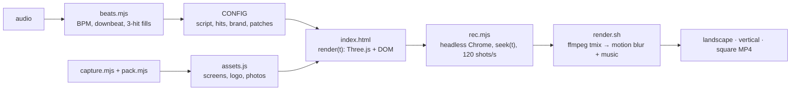

<div align="center">

<a href="https://github.com/DannerAly/promo-video-3d/releases/latest"></a>

# Promo Video 3D

**A Claude skill that turns your app into an Apple‑style 30‑second promo: a 3D laptop and phone showing your real screens, and kinetic type that lands on every beat of the music.**

HTML + Three.js, rendered frame by frame with real motion blur. Landscape, vertical and square from the same file.

[**🌐 Website**](https://danneraly.github.io/promo-video-3d/) · [**▶ Watch the demo (MP4)**](https://github.com/DannerAly/promo-video-3d/releases/latest) · [Install](#install) · [Usage](#usage) · [How it works](#how-it-works) · [🇪🇸 Español](README.es.md)

[](LICENSE)
[](https://code.claude.com/docs/en/skills)
[](https://threejs.org)
[](https://ffmpeg.org)
[](https://github.com/DannerAly/promo-video-3d/stargazers)

</div>

---

No video editor, no keyframes by hand. You give Claude your app, a song and the idea. It writes a short script, measures the beat, screenshots your product, puts it on a 3D laptop and phone, and animates the words so each one hits on a beat. Then it records the page frame by frame and hands you three MP4s.


## Features

- 🎵 **Synced to the music.** A script measures BPM, the first downbeat and the fast "3‑hit" fills that close a phrase. Every word enters on a beat; every cut lands on a bar.
- 💻 **3D laptop and phone** (Three.js) showing **real screenshots** of your product, close enough to read. The camera pushes in until it dives into the screen.
- ✍️ **Kinetic type:** words struck through on each beat, letters that decode from random glyphs, a word that shatters, one‑word slams, letter‑by‑letter rises with blur and rotation.
- 🖼️ **Screen patches:** drop real product photos onto a POS screen, rename an old brand, hide dev overlays, all from `CONFIG`.
- 🎞️ **Real motion blur:** 4 sub‑frames per frame over half a frame (180° shutter), averaged by ffmpeg.
- 📐 **Three formats from one file:** 1920×1080, 1080×1920 and 1080×1080. Type size and camera distance adapt to each.
- 🍎 **Apple‑style:** white background, one typeface, one gradient, smooth easing curves.
- 🧪 **Visual QA:** grab any second as a still before rendering the whole thing.


## Install

### Claude Code (recommended)

```text
/plugin marketplace add DannerAly/promo-video-3d
/plugin install promo-video-3d@danneraly-promo
```

### Manual (skills folder)

```bash
git clone https://github.com/DannerAly/promo-video-3d.git
cp -r promo-video-3d/skills/promo-video-3d ~/.claude/skills/
```

### Claude.ai and Claude Desktop

Download **`promo-video-3d.zip`** from the [latest release](https://github.com/DannerAly/promo-video-3d/releases/latest) and upload it in **Customize → Skills → + → Upload a skill**. (Rendering needs a machine with Chrome and ffmpeg, so Claude Code is the best fit.)

## Usage

> Make a 30‑second Apple‑style promo for my app. Use this song: `~/Downloads/track.mp4`. Show the dashboard on a laptop and the checkout on a phone.

> Haz un video corporativo de 30 segundos de mi sistema, con la compu y el celular en 3D y letras al ritmo de la música. Dámelo en horizontal, vertical y cuadrado.

What Claude does:

1. **Script first:** before → problem → promise → laptop → phone → both → end card, 1–4 words per beat.
2. **Measures the beat** with `scripts/beats.mjs` and asks you to confirm the 3‑hit moments by ear (you can answer in `mm:ss:ff`).
3. **Screenshots your product** (`scripts/capture.mjs`, with optional login) and packs the images (`scripts/pack.mjs`).
4. **Fills `CONFIG`** in a copy of the template.
5. **Checks stills** in all three formats for overlaps and cut‑off devices.
6. **Renders** (`scripts/render.sh`) and opens the videos.

> [!NOTE]
> The skill's instructions are written in Spanish. Claude follows them in any language, and your video comes out in whatever language you ask for.

## How it works



- `render(t)` draws the exact state of second `t` with no dependency on the previous frame, so it can be recorded at any rate and with sub‑frames.
- Timing is written in **bars and beats** (`br(k)`, `bt(n)`) from `CONFIG.bpm` and `CONFIG.firstBeat`, so changing the song moves everything together.
- Devices follow pose tracks `{x, y, z, rx, ry, rz, s}` with CSS‑style cubic‑bezier easing.
- Screens are canvas textures: your screenshot plus `CONFIG.patches`.

## Customize

Everything lives in one block at the top of `template/index.html`:

```js
window.CONFIG = {
  audio: 'audio.m4a', duration: 30,
  bpm: 114, firstBeat: 0.08,
  hits: [[5.30, 5.83, 6.37], [15.83, 16.37, 16.90], [24.27, 24.83, 25.30]],
  hitWords: [['Plan.', 'Charge.', '*Grow.'], ['Web.', '*Mobile.', 'Team.'], ['Simpler.', 'Faster.', '*Better.']],
  strike: ['Notebook.', 'Excel.', 'Emails.', 'Sticky notes.'],
  problem: ['No more', '*chaos.'],
  promise: ['Everything simple,', 'at hand'],
  laptopHead: 'Your whole business, *in *one *place.',
  // … stack, bridge, phoneHead, decode, duoHead, tiles
  brand: { name: 'Nova', tagline: 'Your business, simpler.', url: 'yourapp.com', appStore: true, googlePlay: true },
  patches: { laptop: [], phone: [] },
};
```

A `*` before a word paints it with the gradient. Shot‑by‑shot structure and script ideas are in [`references/patterns.md`](skills/promo-video-3d/references/patterns.md).

## Scripts

```bash
S=skills/promo-video-3d/scripts
node $S/beats.mjs audio.m4a                                  # BPM, downbeat, 3-hit candidates
node $S/capture.mjs shots "laptop|https://app/x|1600|1000|1.2|0" "phone|https://app/y|390|845|2|1"
node $S/pack.mjs my-video laptop=shots/laptop.png phone=shots/phone.png logo=logo.png p1=photo.jpg
node $S/rec.mjs my-video/index.html stills "3,10,20,28"      # quick stills
VW=1080 VH=1920 node $S/rec.mjs my-video/index.html stills "10"
bash $S/render.sh my-video/index.html audio.m4a MyApp        # MyApp-horizontal/vertical/cuadrado.mp4
```

Requires Node 22+, Google Chrome (`CHROME=/path` if it isn't found) and ffmpeg. About 5 minutes per format with a GPU.

## What's inside

```text
promo-video-3d/
├── .claude-plugin/              # marketplace + plugin manifests
└── skills/promo-video-3d/
    ├── SKILL.md                 # workflow, design and rhythm rules, known pitfalls
    ├── template/index.html      # CONFIG + Three.js scene + kinetic type + timeline
    ├── references/patterns.md   # shot structure, scripts that worked, screen patches
    └── scripts/
        ├── beats.mjs            # beat and 3-hit detection
        ├── capture.mjs          # screenshots of your product (optional login)
        ├── pack.mjs             # images → assets.js (data URIs for WebGL)
        ├── rec.mjs              # frame-by-frame recorder (headless Chrome)
        └── render.sh            # 3 formats, motion blur, music
```

## Credits

The demo shows **Maximo**, a point‑of‑sale and inventory system for businesses in Bolivia. The store buttons in the template are look‑alikes; use the official Apple and Google badges when you publish.

## License

[MIT](LICENSE) © 2026 [Aly Danner](https://github.com/DannerAly)
